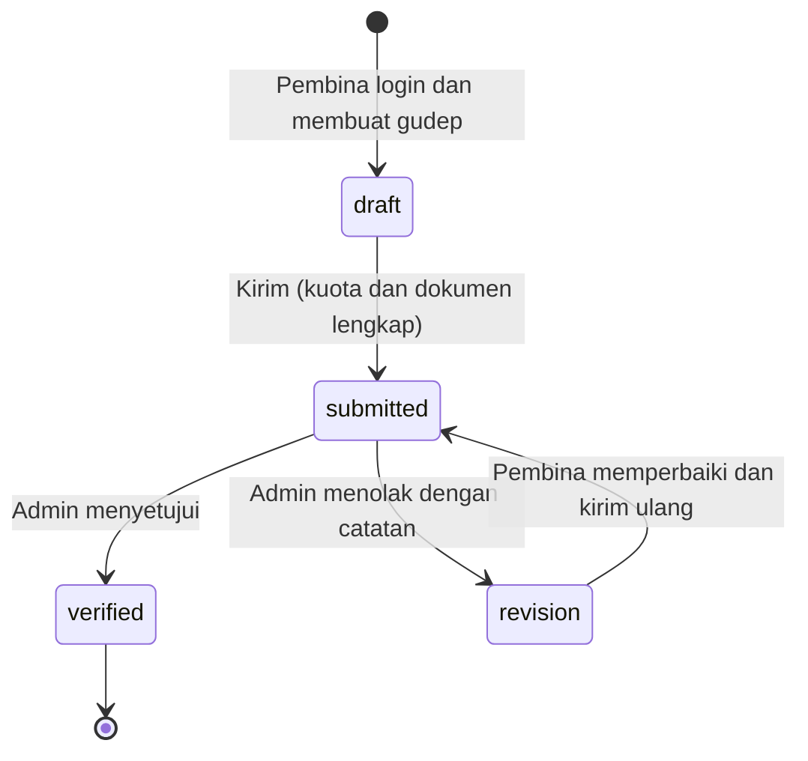
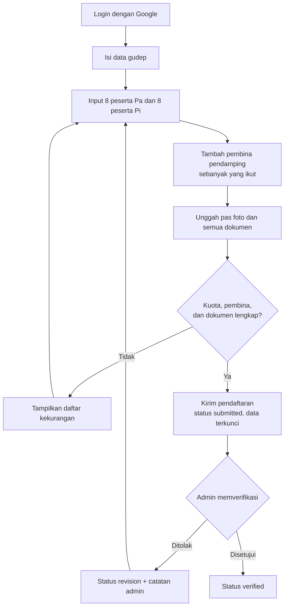
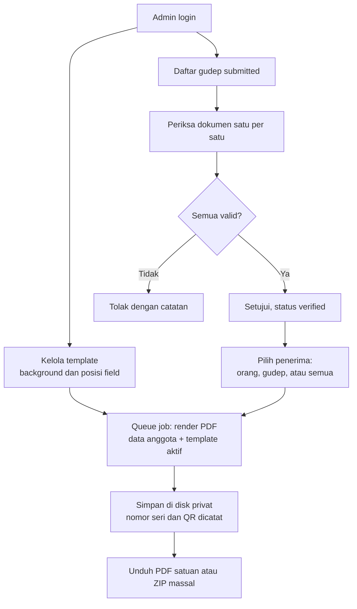
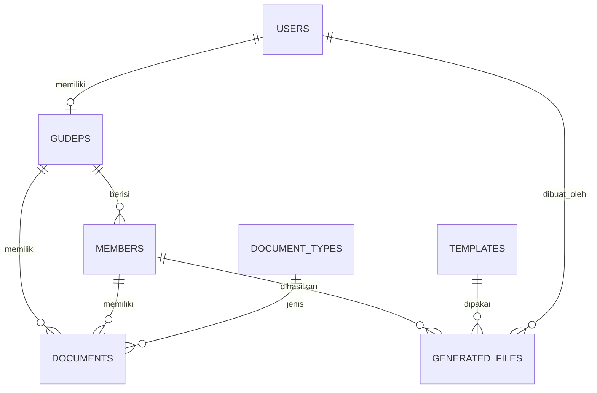

# PRD — Aplikasi Web Pendaftaran Perkemahan LT 2

| | |
|---|---|
| Versi | 1.2 (semua pertanyaan terbuka sudah dijawab) |
| Tanggal | 19 November 2026 |
| Stack | Laravel 13 · React + Inertia · Tailwind CSS + shadcn/ui · MySQL |
| Bahasa antarmuka | Indonesia |

---

## 1. Ringkasan

Aplikasi web untuk mengelola pendaftaran Perkemahan LT 2. Setiap gugus depan (gudep) didaftarkan oleh **Pembina Pendamping** yang login dengan Google. Pembina menginput data gudep, **8 peserta Putra (Pa)**, **8 peserta Putri (Pi)**, dan **sejumlah pembina yang ikut serta (tanpa batas maksimal)**, lalu mengunggah seluruh dokumen persyaratan. **Admin** memverifikasi pendaftaran, kemudian membuat **ID Card** dan **Sertifikat** untuk setiap peserta dan pembina dari template yang dikelola sendiri.

Peserta (anak) **bukan pengguna sistem**. Mereka hanya data yang diinput dan dikelola oleh Pembina Pendamping.

## 2. Tujuan dan non-tujuan

### Tujuan
1. Pendaftaran gudep yang terstruktur, dengan kuota 8 Pa + 8 Pi tervalidasi otomatis.
2. Seluruh dokumen persyaratan terkumpul secara digital dan dapat diperiksa admin dari satu tempat.
3. ID Card dan Sertifikat dibuat massal, konsisten, dan hanya bisa diakses admin.
4. Template ID Card dan Sertifikat bisa diganti admin tanpa mengubah kode.
5. Mudah dipakai dari ponsel, karena sebagian besar pembina akan mengakses lewat HP.

### Non-tujuan (di luar cakupan versi 1.0)
- Pembayaran atau biaya pendaftaran.
- Akun login untuk peserta.
- Absensi atau pencatatan kehadiran saat acara.
- Aplikasi mobile native.

## 3. Pengguna dan peran

| Peran | Cara login | Hak akses |
|---|---|---|
| **Pembina Pendamping** | Google (Socialite). Akun dibuat otomatis saat login pertama. | Mengelola **satu** gudep miliknya: data gudep, anggota (peserta dan pembina), unggah dokumen, kirim pendaftaran, lihat status. |
| **Admin** | Email + password (akun dibuat via seeder atau perintah artisan), 2FA disarankan. | Melihat semua gudep, verifikasi, kelola template, generate dan unduh ID Card serta Sertifikat. |

Peserta bukan peran. Tidak ada halaman, login, atau akses apa pun untuk peserta.

## 4. Aturan bisnis

| Kode | Aturan |
|---|---|
| BR-01 | Satu akun Pembina memiliki tepat **satu** gudep. |
| BR-02 | Satu gudep wajib terdiri dari **tepat 8 peserta Pa dan 8 peserta Pi** (nilai di `config/camp.php`, mudah diubah). |
| BR-03 | Pembina pendamping **minimal 1, tanpa batas maksimal**. Pembina menambah sebanyak yang berpartisipasi. Pemilik akun otomatis menjadi pembina pertama dan tidak dapat dihapus. |
| BR-04 | **Semua dokumen diunggah oleh Pembina**, baik dokumen peserta maupun dokumen pembina. |
| BR-05 | Semua dokumen persyaratan diunggah **per gudep, satu berkas per jenis**: KTA seluruh anggota (peserta dan pembina pendamping), Surat Izin Orang Tua seluruh peserta, dan Surat Keterangan Sehat seluruh anggota, masing-masing digabung menjadi satu PDF, ditambah Surat Kesiapan Sekolah. Jenis dokumen diatur di tabel `document_types`. |
| BR-06 | Tiap anggota wajib memiliki pas foto, dipakai untuk ID Card. |
| BR-07 | Pendaftaran hanya dapat dikirim jika kuota, pembina, foto, dan semua dokumen wajib sudah lengkap. |
| BR-08 | Setelah dikirim, data **terkunci** sampai admin memverifikasi atau meminta revisi. |
| BR-09 | ID Card dan Sertifikat **hanya dapat dibuat untuk anggota gudep berstatus terverifikasi**. |
| BR-10 | ID Card gudep terverifikasi dapat diunduh admin dan **pembina gudep itu** (lembar A4). Sertifikat **hanya dapat diakses admin**. |
| BR-11 | Setiap ID Card dan Sertifikat memiliki nomor seri unik. Sertifikat memuat QR menuju halaman verifikasi publik. |
| BR-12 | Pendaftaran dibuka dan ditutup sesuai jadwal yang diatur admin. Di luar jadwal, pembina hanya dapat melihat data (read-only), kecuali gudep yang mendapat perpanjangan dari admin. **Tidak ada batas jumlah gudep.** |
| BR-13 | Data dan dokumen **tetap disimpan tanpa batas waktu** setelah acara selesai dan tidak dihapus otomatis. |
| BR-14 | Format nomor seri: `LT2-<tahun>-ID-0001` untuk ID Card dan `LT2-<tahun>-CERT-0001` untuk Sertifikat, berurutan per jenis dan diberikan saat pertama kali dibuat. **Generate ulang mempertahankan nomor seri** dan menimpa file. |
| BR-15 | ID Card dan Sertifikat dibuat untuk **semua anggota terverifikasi** (peserta dan pembina). Ukuran ID Card **55 mm × 85 mm** (lebar × tinggi, potret), Sertifikat **A4 lanskap** (297 × 210 mm). |

## 5. Kebutuhan fungsional

Prioritas: **P0** wajib untuk rilis, **P1** penting, **P2** bisa menyusul.

### 5.1 Autentikasi dan akses

| ID | Kebutuhan | Prioritas | Kriteria penerimaan |
|---|---|---|---|
| FR-AUTH-01 | Pembina login dengan Google. | P0 | Login pertama membuat user `role=pembina`. Login berikutnya masuk ke akun yang sama (cocok via `google_id`). |
| FR-AUTH-02 | Admin login terpisah dengan email dan password. | P0 | Halaman `/admin/login` terpisah. Akun Google tidak bisa menjadi admin. |
| FR-AUTH-03 | Pembatasan akses berdasarkan role. | P0 | Pembina yang membuka `/admin/*` mendapat 403. Admin yang membuka area pembina diarahkan ke dashboard admin. |
| FR-AUTH-04 | Pembina hanya melihat data gudepnya sendiri. | P0 | Akses ke gudep, anggota, atau dokumen milik pembina lain ditolak (Policy). |
| FR-AUTH-05 | 2FA untuk admin. | P2 | Opsional via Fortify. |

### 5.2 Data gudep dan anggota

| ID | Kebutuhan | Prioritas | Kriteria penerimaan |
|---|---|---|---|
| FR-GDP-01 | Pembina mengisi data gudep (NPSN, nama instansi, penanggung jawab, alamat, nomor gudep). | P0 | Tersimpan sebagai draft, bisa dilanjutkan di sesi berikutnya. |
| FR-GDP-02 | Input peserta Pa (8 orang) dan Pi (8 orang) dalam dua bagian terpisah. | P0 | Indikator kuota "x/8" per regu. Peserta ke-9 per regu ditolak. |
| FR-GDP-03 | Input pembina pendamping secara **dinamis**: tombol "Tambah pembina" menambah baris baru tanpa batas, tombol hapus per baris. | P0 | Minimal 1 baris. Baris pertama (pemilik akun) tidak bisa dihapus. Jumlah tidak dibatasi (`pembina_max = null`). |
| FR-GDP-04 | Data per anggota: nama lengkap, jenis kelamin, tanggal lahir, nomor KTA, pas foto. Pembina juga memiliki nomor HP dan keterangan mendampingi Pa, Pi, atau keduanya. | P0 | Validasi wajib dan format di backend (FormRequest) dan UI. |
| FR-GDP-05 | Edit dan hapus anggota selama status `draft` atau `revision`. | P0 | Saat `submitted` atau `verified` semua form terkunci (read-only). |
| FR-GDP-06 | Import peserta dari file Excel/CSV. | P2 | Template unduhan disediakan, baris tidak valid dilaporkan. |

### 5.3 Dokumen

| ID | Kebutuhan | Prioritas | Kriteria penerimaan |
|---|---|---|---|
| FR-DOC-01 | Pembina mengunggah empat dokumen per gudep: KTA gabungan, Izin Orang Tua gabungan, Keterangan Sehat gabungan, dan Kesiapan Sekolah. | P0 | Satu berkas per jenis. Format PDF/JPG/PNG, maksimal 10 MB (`max_upload_kb` di `config/camp.php`; pas foto tetap 2 MB lewat `max_photo_kb`). Pelanggaran ditolak dengan pesan jelas. |
| FR-DOC-02 | Kelengkapan: empat kartu dokumen gudep dengan status (belum, diunggah, disetujui, ditolak) dan daftar pas foto per anggota. | P0 | Terlihat sekilas dokumen atau pas foto mana yang kurang. |
| FR-DOC-03 | Ganti (unggah ulang) dokumen yang ditolak. | P0 | File lama diarsipkan, status kembali `pending`. |
| FR-DOC-04 | Penyimpanan dokumen privat. | P0 | File di disk privat, diakses lewat controller dengan otorisasi. URL file tidak bisa ditebak atau dibagikan. |
| FR-DOC-05 | Pratinjau dokumen di browser. | P1 | PDF dan gambar tampil di dialog tanpa unduh. |

### 5.4 Pengiriman dan verifikasi

| ID | Kebutuhan | Prioritas | Kriteria penerimaan |
|---|---|---|---|
| FR-VER-01 | Tombol "Kirim pendaftaran" dengan cek kelengkapan. | P0 | Jika ada yang kurang, tampil daftar kekurangan dan status tetap `draft`. Jika lengkap, status `submitted` dan data terkunci. |
| FR-VER-02 | Admin melihat daftar gudep dengan filter status dan pencarian. | P0 | Filter draft/submitted/revision/verified, cari nama gudep atau sekolah. |
| FR-VER-03 | Panel verifikasi: admin memeriksa tiap dokumen (setuju/tolak dengan catatan). | P0 | Gudep hanya bisa `verified` jika semua dokumen disetujui. |
| FR-VER-04 | Tolak pendaftaran dengan catatan, status menjadi `revision`. | P0 | Pembina melihat catatan di dashboard, bisa memperbaiki dan mengirim ulang. |
| FR-VER-05 | Notifikasi email ke pembina saat status berubah. | P1 | Email terkirim via queue. |
| FR-VER-06 | Riwayat aktivitas (audit log) verifikasi. | P1 | Siapa, kapan, apa perubahannya. |
| FR-VER-07 | Formulir Pendaftaran (PDF berkop Kwartir Ranting Kepenuhan) berisi data gudep, peserta, dan pembina. | P1 | Hanya admin, tombol **Unduh formulir** di samping tombol verifikasi setelah gudep terverifikasi. |

### 5.5 Template ID Card dan Sertifikat

| ID | Kebutuhan | Prioritas | Kriteria penerimaan |
|---|---|---|---|
| FR-TPL-01 | Admin mengelola template terpisah untuk ID Card dan Sertifikat. | P0 | Jenis template: `id_card` atau `certificate`. Bisa lebih dari satu, hanya satu yang aktif per jenis dan sasaran. |
| FR-TPL-02 | Template menyimpan gambar background, ukuran kertas (mm), dan daftar field beserta posisi, font, ukuran, rata teks. Ukuran bawaan ID Card **55 × 85 mm**. | P0 | Disimpan sebagai data (kolom JSON), bukan kode. Editor dan PDF memakai ukuran yang sama persis. |
| FR-TPL-03 | Sasaran template: peserta, pembina, atau keduanya. | P0 | Pembina dan peserta bisa memakai desain berbeda. |
| FR-TPL-04 | Editor visual: admin menggeser field di atas gambar background dan melihat pratinjau dengan data contoh. | P1 | Perubahan posisi tersimpan dan terlihat di PDF hasil. |
| FR-TPL-05 | Field yang tersedia: nama, peran, nama gudep, nama instansi, NPSN, penanggung jawab, alamat, foto, nomor seri, QR. | P0 | Field bisa ditambah/dihilangkan per template. |

### 5.6 Pembuatan ID Card dan Sertifikat

| ID | Kebutuhan | Prioritas | Kriteria penerimaan |
|---|---|---|---|
| FR-GEN-01 | Admin memilih penerima: satu orang, satu gudep, atau semua gudep terverifikasi. | P0 | Anggota gudep non-verified tidak bisa dipilih. |
| FR-GEN-02 | Proses pembuatan berjalan di background (queue) dengan indikator progres. | P0 | Generate ratusan file tidak membuat halaman menggantung. |
| FR-GEN-03 | Setiap hasil memiliki nomor seri unik (format di BR-14) dan tercatat di `generated_files`. | P0 | Generate ulang **mempertahankan nomor seri** dan menimpa file. Penomoran aman dari duplikasi saat beberapa job berjalan bersamaan. |
| FR-GEN-04 | Unduh PDF satuan dan ZIP massal per gudep atau seluruhnya. | P0 | Admin; pembina hanya ID Card gudepnya sendiri setelah terverifikasi (lembar A4 9 kartu). ID Card dalam satu PDF multi-halaman siap cetak. ID Card dibuat otomatis saat gudep diverifikasi bila template aktif tersedia. |
| FR-GEN-05 | Halaman verifikasi publik `/verify/{serial}`. | P1 | Menampilkan nama, gudep, dan status keabsahan. Tanpa data sensitif. |
| FR-GEN-06 | Mode cetak ID Card: satu kartu per halaman 55 × 85 mm, atau lembar A4 berisi 9 kartu (3 × 3) dengan garis potong. | P1 | PDF A4 muat tepat 9 kartu tanpa terpotong. Pilihan mode ada di halaman generate. |

### 5.7 Dashboard admin

| ID | Kebutuhan | Prioritas | Kriteria penerimaan |
|---|---|---|---|
| FR-DSH-01 | Ringkasan: jumlah gudep per status, total peserta dan pembina, dokumen menunggu verifikasi. | P1 | Angka sesuai data terbaru. |
| FR-DSH-02 | Ekspor daftar gudep dan anggota ke Excel. | P2 | Berisi nama, gudep, peran, status dokumen. |

### 5.8 Periode pendaftaran

| ID | Kebutuhan | Prioritas | Kriteria penerimaan |
|---|---|---|---|
| FR-PRD-01 | Admin mengatur tanggal dan jam **buka** dan **tutup** pendaftaran dari dashboard. | P0 | Nilai tersimpan di tabel `settings`, bisa diubah kapan saja, memakai zona waktu aplikasi (`Asia/Jakarta`). |
| FR-PRD-02 | Penutupan berlaku otomatis di server tanpa penjadwal: setiap aksi pembina membandingkan waktu sekarang dengan jadwal. | P0 | Setelah tutup, pembina tidak bisa membuat gudep, mengubah anggota, mengunggah dokumen, atau mengirim pendaftaran. Halaman menjadi read-only. Sebelum buka, tampil pesan "pendaftaran belum dibuka". |
| FR-PRD-03 | Banner batas waktu di dashboard pembina. | P1 | Menampilkan status (belum dibuka / dibuka / ditutup) dan hitung mundur. |
| FR-PRD-04 | Perpanjangan per gudep: admin mengisi `deadline_extended_until`. | P1 | Gudep dengan perpanjangan aktif tetap bisa mengubah dan mengirim sampai batas itu, gudep lain tetap tertutup. |
| FR-PRD-05 | Saat admin menolak pendaftaran (status `revision`) setelah penutupan, admin menentukan tenggat revisi. | P1 | Pembina bisa memperbaiki sampai tenggat itu. Tanpa tenggat, gudep tetap terkunci. |

Admin tidak terikat jadwal ini. Tidak ada batas jumlah gudep yang dapat mendaftar.

## 6. Alur sistem

### 6.1 Status pendaftaran gudep



### 6.2 Alur Pembina Pendamping



### 6.3 Alur Admin: verifikasi hingga ID Card dan Sertifikat



## 7. Model data



| Tabel | Kolom penting |
|---|---|
| `users` | `id`, `google_id` (nullable, unik), `name`, `email` (unik), `avatar`, `role` (`admin`/`pembina`), `password` (hanya admin) |
| `gudeps` | `id`, `user_id` (unik), `name`, `gudep_number`, `npsn`, `institution`, `pic_name`, `address`, `status` (`draft`/`submitted`/`revision`/`verified`), `admin_note`, `deadline_extended_until` (nullable), `submitted_at`, `verified_at` |
| `members` | `id`, `gudep_id`, `role` (`peserta`/`pembina_pendamping`), `group` (`pa`/`pi`, nullable untuk pembina), `name`, `gender`, `birth_date`, `kta_number`, `phone` (pembina), `photo_path`, `is_owner` (pembina pemilik akun) |
| `document_types` | `id`, `code` (`kta`/`izin_ortu`/`kesehatan`/`kesiapan_sekolah`), `label`, `scope` (`member`/`gudep`), `required_for` (JSON: peserta/pembina) |
| `documents` | `id`, `gudep_id`, `member_id` (nullable), `document_type_id`, `path`, `status` (`pending`/`approved`/`rejected`), `note`, `uploaded_by`, `reviewed_by`, `reviewed_at` |
| `templates` | `id`, `type` (`id_card`/`certificate`), `applies_to` (`peserta`/`pembina`/`all`), `name`, `background_path`, `width_mm`, `height_mm`, `fields` (JSON), `is_active` |
| `generated_files` | `id`, `member_id`, `template_id`, `type`, `serial_number` (unik), `path`, `generated_by`, `generated_at` |
| `settings` | `key` (unik), `value`, `updated_by`. Contoh: `registration_open_at`, `registration_close_at` |
| `activity_logs` | `id`, `user_id`, `subject_type`, `subject_id`, `action`, `meta` (JSON), `created_at` |

Konfigurasi `config/camp.php`:

```php
return [
    'peserta_per_regu' => 8,        // Pa = 8, Pi = 8
    'groups'           => ['pa', 'pi'],
    'pembina_min'      => 1,
    'pembina_max'      => null,     // null = tanpa batas
    'max_upload_kb'    => 2048,
    'allowed_mimes'    => ['pdf', 'jpg', 'jpeg', 'png'],
    'event_year'       => 2026,             // dipakai pada nomor seri
    'serial_prefix'    => 'LT2',
    'timezone'         => 'Asia/Jakarta',
    'id_card_mm'       => ['width' => 55,  'height' => 85],
    'certificate_mm'   => ['width' => 297, 'height' => 210], // A4 lanskap (diputuskan)
];
```

Jadwal buka/tutup pendaftaran **tidak** disimpan di file config, tetapi di tabel `settings` agar admin bisa mengubahnya tanpa deploy.

```php
// contoh pemakaian
Setting::get('registration_close_at');
```

## 8. Arsitektur dan struktur folder

Pola: controller tipis, logika bisnis di `Actions`, validasi di `FormRequest`, otorisasi di `Policies`, tugas berat di `Jobs`.

```
lt2-camp/
├── app/
│   ├── Actions/
│   │   ├── Gudep/            # CreateGudep, SaveMember, DeleteMember, SubmitRegistration
│   │   ├── Documents/        # StoreDocument, ReplaceDocument
│   │   ├── Verification/     # ApproveGudep, RejectGudep, ReviewDocument
│   │   └── Generate/         # GenerateIdCard, GenerateCertificate
│   ├── Enums/                # UserRole, MemberRole, TeamGroup, GudepStatus,
│   │                         # DocumentStatus, TemplateType
│   ├── Http/
│   │   ├── Controllers/
│   │   │   ├── Auth/         # GoogleController, AdminLoginController
│   │   │   ├── Pembina/      # Dashboard, Gudep, Member, Document, Submission
│   │   │   ├── Admin/        # Dashboard, Gudep, Verification, Template,
│   │   │   │                 # IdCard, Certificate, Setting (jadwal pendaftaran)
│   │   │   └── Public/       # VerifyCertificateController
│   │   ├── Middleware/       # EnsureRole, EnsureRegistrationOpen, HandleInertiaRequests
│   │   ├── Requests/         # per aksi, termasuk validasi kuota 8 Pa + 8 Pi
│   │   └── Resources/
│   ├── Jobs/                 # GenerateIdCardJob, GenerateCertificateJob, BuildZipJob
│   ├── Models/               # User, Gudep, Member, Document, DocumentType,
│   │                         # Template, GeneratedFile, Setting, ActivityLog
│   ├── Policies/             # GudepPolicy, DocumentPolicy, GeneratedFilePolicy
│   └── Services/
│       ├── Pdf/TemplateRenderer.php
│       ├── Qr/QrCodeService.php
│       └── Files/PrivateFileService.php
├── config/                   # camp.php, services.php (Google OAuth)
├── database/                 # migrations, factories, seeders
├── resources/
│   ├── js/
│   │   ├── app.tsx · ssr.tsx
│   │   ├── pages/
│   │   │   ├── welcome.tsx
│   │   │   ├── auth/         # login.tsx, admin-login.tsx
│   │   │   ├── pembina/      # dashboard.tsx, gudep/form.tsx, members/index.tsx,
│   │   │   │                 # documents/index.tsx, submit.tsx
│   │   │   └── admin/        # dashboard, gudeps/{index,show}, templates/{index,editor},
│   │   │                     # id-cards/index, certificates/index
│   │   ├── layouts/          # public-layout, pembina-layout, admin-layout
│   │   ├── components/
│   │   │   ├── ui/           # shadcn/ui
│   │   │   ├── gudep/        # member-form, regu-card, quota-indicator, pembina-repeater
│   │   │   ├── documents/    # upload-dropzone, document-matrix, status-badge
│   │   │   └── admin/        # verification-panel, template-canvas, pdf-preview
│   │   ├── hooks/ · lib/ · types/
│   └── views/
│       ├── app.blade.php
│       └── pdf/              # id-card.blade.php, certificate.blade.php
├── routes/                   # web.php, pembina.php, admin.php
├── storage/app/
│   ├── private/              # documents/, photos/, generated/
│   └── public/templates/     # background template
└── tests/                    # Feature (alur utama), Unit (Actions, validasi kuota)
```

### Paket pendukung yang diusulkan

| Kebutuhan | Paket |
|---|---|
| Login Google | `laravel/socialite` |
| Auth admin, 2FA | `laravel/fortify` (sudah ada di starter kit React) |
| PDF | `barryvdh/laravel-dompdf` (sederhana) atau `spatie/laravel-pdf` (render HTML/CSS lebih akurat) |
| QR code | `simplesoftwareio/simple-qrcode` |
| Pengolah gambar | `intervention/image` |
| Queue | driver `database` (cukup untuk skala ini) |
| Import/ekspor Excel (P2) | `maatwebsite/excel` |

## 9. Kebutuhan non-fungsional

- **Keamanan:** semua dokumen di disk privat dan hanya dilayani lewat controller yang memeriksa Policy. Validasi MIME asli file (bukan hanya ekstensi), batas ukuran, nama file diacak. CSRF dan rate limiting pada login serta unggah.
- **Privasi:** data peserta adalah data anak dan dokumen kesehatan. Akses hanya admin dan pembina pemilik gudep. Halaman verifikasi publik tidak menampilkan data sensitif. Sediakan kebijakan privasi singkat dan pernyataan persetujuan pada form pendaftaran.
- **Performa:** generate ID Card dan Sertifikat massal berjalan di queue. Halaman daftar memakai paginasi.
- **Responsif:** tampilan mobile-first, karena pembina kemungkinan mengakses dari ponsel (termasuk unggah foto dokumen dari kamera).
- **Keandalan:** backup database dan folder `storage/app/private` terjadwal. Operasi tulis penting dibungkus transaksi.
- **Aksesibilitas:** komponen shadcn/ui yang aksesibel, kontras warna memadai, label form jelas.
- **Jejak audit:** perubahan status dan verifikasi dokumen tercatat di `activity_logs`.
- **Retensi:** data dan dokumen tetap disimpan setelah acara (BR-13). Tidak ada penghapusan otomatis. Backup mencakup database dan folder dokumen privat.

## 10. Rencana pengerjaan

Estimasi di bawah mengasumsikan 1 sampai 2 developer dan hanya perkiraan awal. Fase 0 sampai 4 membentuk MVP: pembina bisa mendaftar dan admin bisa memverifikasi.

| Fase | Fokus | Hasil utama | Estimasi |
|---|---|---|---|
| **0. Fondasi** | Skeleton Laravel 13 + React Inertia + Tailwind + shadcn, koneksi MySQL, konfigurasi Google OAuth di Google Cloud Console, pipeline lint/test, struktur folder. | Proyek berjalan di lokal dan staging. | 2–3 hari |
| **1. Auth dan role** | Login Google untuk pembina, login admin, middleware `EnsureRole`, seeder admin, layout per peran. | Pembina dan admin masuk ke dashboard masing-masing. | 3–4 hari |
| **2. Gudep dan anggota** | CRUD gudep, form peserta Pa dan Pi dengan indikator kuota 8/8, **repeater pembina dinamis tanpa batas**, upload pas foto, aturan kunci data. | Pembina menyelesaikan seluruh data gudep. | 1 minggu |
| **3. Dokumen** | Unggah per anggota dan per gudep, matriks kelengkapan, penyimpanan privat, pratinjau, unggah ulang. | Semua dokumen terkumpul dan terlindungi. | 4–5 hari |
| **4. Submit dan verifikasi** | Pengaturan jadwal buka/tutup pendaftaran dan perpanjangan per gudep, validasi kelengkapan saat kirim, daftar dan panel verifikasi admin, setuju/tolak dengan catatan, alur revisi, audit log, email notifikasi. | Alur pendaftaran end-to-end berjalan (**MVP**). | 1 minggu |
| **5. Template** | Model template, unggah background, definisi field (JSON), editor posisi dan pratinjau pada ukuran asli (ID Card 55 × 85 mm), template per sasaran (peserta/pembina). | Admin dapat membuat dan mengaktifkan template. | 1 minggu |
| **6. Generate ID Card dan Sertifikat** | Renderer template ke PDF, nomor seri format `LT2-<tahun>-ID/CERT-0001` (dipertahankan saat generate ulang), QR, queue job, mode cetak satu kartu atau lembar A4 berisi 9 kartu, unduh satuan dan ZIP, halaman verifikasi publik. | ID Card dan Sertifikat siap cetak. | 1 minggu |
| **7. Penyempurnaan** | Dashboard admin, ekspor Excel, import peserta (opsional), perapian UI mobile, aksesibilitas. | Pengalaman pengguna matang. | 3–5 hari |
| **8. Pengujian dan rilis** | Uji fitur otomatis alur utama, UAT bersama panitia dengan data nyata, uji beban singkat, perbaikan, deploy produksi, backup, panduan pengguna singkat. | Rilis produksi. | 1 minggu |

Total perkiraan: **sekitar 6–8 minggu** kalender untuk cakupan penuh. Jika tenggat pendaftaran ketat, rilis MVP (fase 0–4) lebih dulu, lalu template dan generate menyusul sebelum acara.

### Definition of Done per fitur
- Kriteria penerimaan pada bagian 5 terpenuhi.
- Validasi dan otorisasi di backend memiliki uji otomatis.
- Tampilan sudah dicek di ukuran layar ponsel dan desktop.
- Tidak ada akses data lintas gudep (diuji).

## 11. Strategi pengujian

- **Unit:** Actions (hitung kuota 8/8, aturan minimal pembina, kelengkapan dokumen), `TemplateRenderer`.
- **Feature (Pest):** login Google (dengan mock Socialite), pembatasan role, alur kirim dan verifikasi, penolakan akses lintas gudep, generate hanya untuk gudep terverifikasi, unduh hanya oleh admin.
- **UAT:** panitia mencoba mendaftarkan 3 sampai 5 gudep nyata dari ponsel, lalu memeriksa hasil ID Card dan Sertifikat sebelum dicetak massal.

## 12. Risiko dan mitigasi

| Risiko | Dampak | Mitigasi |
|---|---|---|
| Pembina kesulitan mengunggah dokumen dari ponsel (ukuran besar). | Pendaftaran tertunda. | Kompres gambar otomatis di sisi klien, pesan error yang jelas, panduan singkat. |
| Hasil cetak tidak presisi (posisi field, ukuran). | ID Card/Sertifikat harus dicetak ulang. | Pratinjau di editor, uji cetak satu contoh sebelum generate massal. |
| Generate massal membebani server. | Halaman lambat atau gagal. | Queue worker, proses per orang, ZIP dibuat di background. |
| Kebocoran dokumen pribadi anak. | Risiko hukum dan reputasi. | Disk privat, Policy ketat, tanpa URL publik, audit log, HTTPS wajib. |
| Pembina salah input data lalu terkunci. | Data keliru di ID Card. | Admin dapat mengembalikan ke `revision`, serta halaman koreksi sebelum generate. |
| Google OAuth salah konfigurasi di produksi. | Pembina tidak bisa login. | Uji di staging dengan domain final, siapkan redirect URI produksi lebih awal. |

## 13. Keputusan

### Sudah diputuskan

| # | Topik | Keputusan |
|---|---|---|
| 1 | Batas pendaftaran | Ada **batas tanggal pendaftaran**. Tidak ada batas jumlah gudep (BR-12, bagian 5.8). |
| 2 | Format nomor seri | `LT2-<tahun>-ID-0001` untuk ID Card dan `LT2-<tahun>-CERT-0001` untuk Sertifikat (BR-14). |
| 3 | Penerima sertifikat | Semua anggota terverifikasi, tanpa data kehadiran (BR-15). |
| 4 | Izin orang tua untuk pembina | Tidak diperlukan (BR-05). |
| 5 | Retensi data | Data dan dokumen tetap disimpan setelah acara (BR-13). |
| 6 | Ukuran ID Card | 55 mm × 85 mm, lebar × tinggi (BR-15). |
| 7 | Generate ulang | Nomor seri dipertahankan, file ditimpa (BR-14). |
| 8 | Jadwal buka/tutup | Diisi admin lewat dashboard (tabel `settings`), tanpa nilai tetap di kode. |
| 9 | Ukuran Sertifikat | A4 lanskap, 297 × 210 mm. |
| 10 | Lama penyimpanan | Tanpa batas waktu. |
| 11 | Tahun pada nomor seri | 2026 (`event_year`). |
| 12 | Revisi setelah tutup | Gudep berstatus revisi hanya bisa diperbaiki jika admin memberi tenggat revisi (FR-PRD-05). |

Tidak ada pertanyaan yang tersisa. Perubahan di kemudian hari dicatat sebagai revisi dokumen ini.

## 14. Glosarium

| Istilah | Arti |
|---|---|
| Gudep | Gugus depan, unit pendaftar. |
| Pa / Pi | Putra / Putri. |
| Regu | Kelompok 8 peserta, satu regu Pa dan satu regu Pi per gudep. |
| Pembina Pendamping | Orang dewasa yang mendampingi gudep dan sekaligus pengguna sistem. |
| KTA | Kartu Tanda Anggota Pramuka. |
| LT 2 | Perkemahan yang didaftarkan melalui aplikasi ini. |
